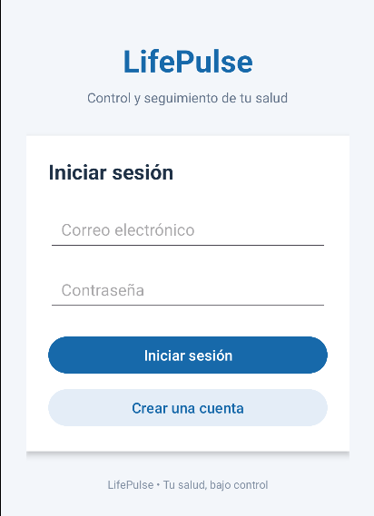
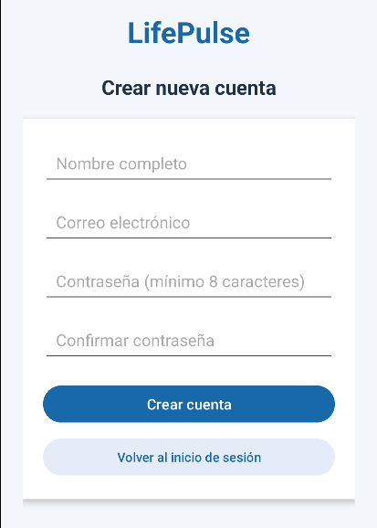
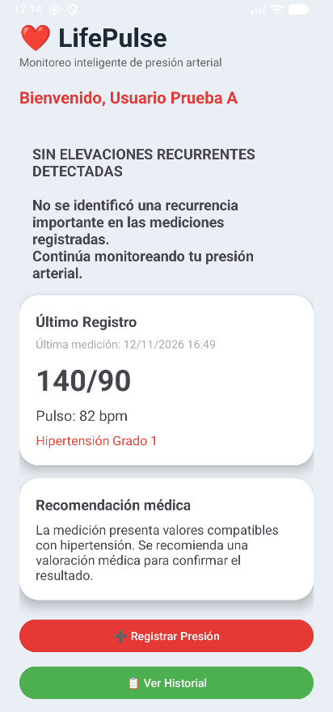
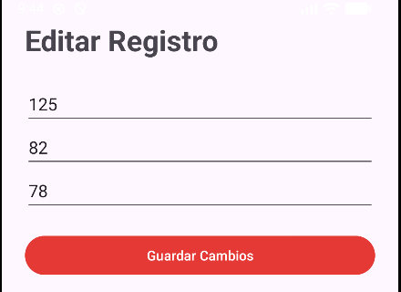
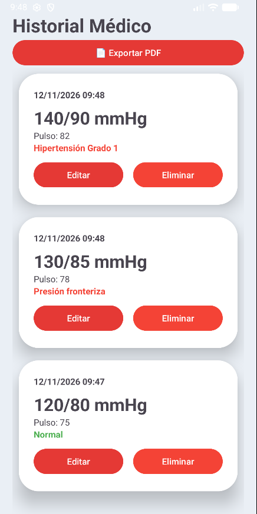
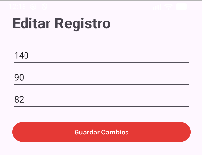
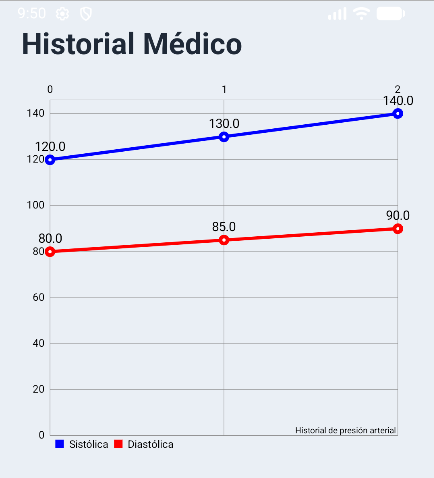
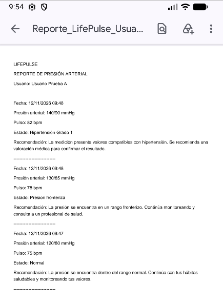

# LifePulse – Aplicación móvil para el seguimiento de la presión arterial

## 1. Descripción del proyecto

**LifePulse** es una aplicación móvil desarrollada para dispositivos Android que permite registrar, almacenar y consultar mediciones de presión arterial y pulso cardíaco.

El proyecto busca facilitar el seguimiento personal de estos indicadores mediante una interfaz sencilla, organizada y accesible. Además, permite crear diferentes perfiles de usuario para mantener los registros independientes.

La aplicación fue desarrollada como proyecto académico de Ingeniería en Ciencias Computacionales, aplicando conocimientos de programación móvil, bases de datos, seguridad informática y aseguramiento de la calidad del software.

## 2. Objetivo general

Desarrollar una aplicación móvil que permita gestionar registros de presión arterial y pulso cardíaco, proporcionando herramientas para consultar el historial, visualizar gráficas y generar reportes en formato PDF.

## 3. Tecnologías utilizadas

- **Lenguaje de programación:** Java.
- **Entorno de desarrollo:** Android Studio.
- **Interfaz gráfica:** XML.
- **Base de datos:** SQLite.
- **Gestión de datos:** SQLiteOpenHelper.
- **Gráficas:** MPAndroidChart.
- **Generación de documentos:** iText.
- **Pruebas:** JUnit y AndroidX Test.
- **Control de versiones:** Git.
- **Repositorio remoto:** GitHub.

## 4. Funcionalidades principales

### 4.1. Registro e inicio de sesión
Permite crear cuentas de usuario e ingresar a la aplicación mediante correo electrónico y contraseña.

### 4.2. Gestión de perfiles
Cada usuario dispone de sus propios registros, evitando que las mediciones de diferentes perfiles se mezclen.

### 4.3. Registro de mediciones
Permite almacenar los siguientes datos:

- Presión sistólica.
- Presión diastólica.
- Pulso cardíaco.
- Fecha del registro.
- Estado y recomendación informativa.

### 4.4. Historial de mediciones
Muestra los registros guardados, organizados desde el más reciente hasta el más antiguo.

### 4.5. Edición y eliminación
Permite modificar o eliminar mediciones previamente registradas.

### 4.6. Visualización gráfica
Presenta gráficamente las mediciones para facilitar la observación de sus cambios a lo largo del tiempo.

### 4.7. Generación de reportes PDF
Permite generar un documento PDF con el historial de mediciones del usuario.

### 4.8. Análisis informativo
La aplicación muestra estados y recomendaciones con base en reglas programadas. Esta funcionalidad es únicamente informativa y no sustituye una valoración médica.

## 5. Seguridad y almacenamiento

LifePulse utiliza SQLite para almacenar localmente la información de los usuarios y sus mediciones.

La aplicación implementa un mecanismo de derivación de contraseñas mediante PBKDF2 con salt, evitando almacenar las contraseñas directamente en texto plano.

La información se organiza mediante una relación entre usuarios y registros, permitiendo mantener separados los datos de cada perfil.

## 6. Arquitectura y organización del proyecto

El proyecto utiliza una organización modular en Java, separando las actividades de interfaz, la lógica de procesamiento y el acceso a los datos.

Algunas de las clases principales son:

| Clase | Responsabilidad |
|---|---|
| MainActivity | Pantalla principal o Dashboard. |
| LoginActivity | Inicio de sesión. |
| RegistroUsuarioActivity | Creación de usuarios. |
| RegistroActivity | Captura de mediciones. |
| HistorialActivity | Consulta del historial. |
| GraficaActivity | Visualización gráfica. |
| EditarRegistroActivity | Edición de mediciones. |
| DBHelper | Administración de SQLite. |
| PasswordUtils | Derivación y verificación de contraseñas. |
| SesionManager | Administración de la sesión del usuario. |
| SaludHelper | Análisis informativo de las mediciones. |

## 7. Estructura de la base de datos

La base de datos utiliza dos tablas principales:

**Tabla usuarios**
- id_usuario
- nombre
- correo
- password_hash

**Tabla registros**
- id
- id_usuario
- sistolica
- diastolica
- pulso
- fecha
- estado
- recomendacion

La relación entre ambas tablas es de uno a muchos: un usuario puede tener múltiples registros de mediciones.

## 8. Evidencias de funcionamiento

Las siguientes imágenes muestran las principales pantallas y funcionalidades implementadas en LifePulse.

### 8.1. Inicio de sesión

*Figura 1. Pantalla de inicio de sesión de LifePulse.*

### 8.2. Registro de usuarios

*Figura 2. Formulario para crear una cuenta de usuario.*

### 8.3. Dashboard principal

*Figura 3. Dashboard principal de LifePulse.*

### 8.4. Registro de mediciones

*Figura 4. Formulario de captura de mediciones.*

### 8.5. Historial de mediciones

*Figura 5. Historial de mediciones del usuario.*

### 8.6. Edición de registros

*Figura 6. Edición de un registro existente.*

### 8.7. Visualización gráfica

*Figura 7. Visualización gráfica del historial.*

### 8.8. Generación de PDF

*Figura 8. Ejemplo del reporte generado por LifePulse.*

## 9. Pruebas de software

Durante el desarrollo se realizaron pruebas para verificar el funcionamiento de los módulos principales de la aplicación.

Entre las pruebas consideradas se encuentran:

- Registro e inicio de sesión.
- Validación de credenciales.
- Separación de información entre perfiles.
- Registro, edición y eliminación de mediciones.
- Consulta del historial.
- Visualización de gráficas.
- Generación de documentos PDF.
- Pruebas unitarias e instrumentadas.
- Pruebas de rendimiento sobre operaciones de almacenamiento y consulta.

Como parte de las pruebas de rendimiento se evaluó el manejo de 500 registros, obteniendo en una ejecución de prueba un tiempo de inserción de 202 ms y un tiempo de consulta de 1 ms en el emulador utilizado.

## 10. Instalación y ejecución

Para revisar el proyecto desde Android Studio:

1. Descargar o clonar el repositorio.
2. Abrir Android Studio.
3. Seleccionar **Open**.
4. Elegir la carpeta principal de LifePulse.
5. Esperar a que Gradle sincronice las dependencias.
6. Iniciar un emulador Android o conectar un dispositivo compatible.
7. Ejecutar la aplicación mediante el botón **Run**.

**Repositorio:**  
https://github.com/LuisRamonCamacho/LifePulse

## 11. Limitaciones del proyecto

- La aplicación está desarrollada para Android.
- La información se almacena localmente en SQLite.
- Los registros se capturan manualmente.
- No cuenta con sincronización en la nube.
- No se conecta directamente con dispositivos de medición Bluetooth.
- Los resultados y recomendaciones son informativos y no representan un diagnóstico médico.

## 12. Mejoras futuras

Entre las posibles mejoras se consideran:

- Sincronización de información en la nube.
- Integración con dispositivos de medición Bluetooth.
- Recordatorios para registrar mediciones.
- Estadísticas y reportes adicionales.
- Compatibilidad con más dispositivos Android.

## 13. Autoría

**Proyecto:** LifePulse.  
**Desarrollador:** Luis Ramon Camacho.  
**Programa académico:** Ingeniería en Ciencias Computacionales.  
**Institución:** Universidad de Guadalajara.  
**Repositorio:** https://github.com/LuisRamonCamacho/LifePulse.

---

*LifePulse es un proyecto académico con fines de seguimiento y organización de información personal de salud. No sustituye la evaluación, diagnóstico ni tratamiento de un profesional de la salud.*